# AbhayNayan architecture and implementation boundaries

**Build:** 0.1.x hackathon prototype · **Date:** 9 October 2026  
**Safety:** This is not a diagnostic device or clinically validated system. Demo values are fixed synthetic fixtures and are never derived from camera pixels or optical features.

## End-to-end dataflow

```mermaid
flowchart TD
  subgraph ANDROID[Native Android source · Kotlin / Compose]
    A[Patient profile stored in Room] --> B[Camera2 rear preview or abstract synthetic chart]
    B --> C[Ambient preview snapshot]
    C --> D{Torch / flash supported?}
    D -- yes --> E[Best-effort flash preview snapshot]
    D -- no / error --> F[Ambient-only fallback]
    E --> G[Manual geometric ROI crop]
    F --> G
    G --> H[Prototype clipped F minus A visualization]
    H --> I[RGB, ratios, CIE Lab*, YCrCb, variance, valid-pixel features]
    I --> J[Developer preview / engineering checks]
    J -. not used as biomarker inference input .-> K[Select named fixed synthetic case]
    K --> L[Safety-labelled demo result]
    L --> M[Local English / Hindi / Bhojpuri copy + optional TTS]
    L --> N[Room screening history]
    L --> O[FHIR-style local JSON / referral brief share]
  end

  subgraph PWA[FastAPI-served installable PWA]
    P[Local patient profile + IndexedDB] --> Q[Camera or local image in browser memory]
    Q --> R[Quality and optical feature visualization]
    R -. only an explicitly selected demo profile/case .-> S[Fixed synthetic fixture]
    S --> T[Local result, safety copy, counselling, FHIR-style export]
    T --> U[IndexedDB outbox]
    U --> V[FastAPI demo sync / SQLite]
    T --> W[Optional structured Gemini copilot]
    W --> X[Schema validation + safe local fallback]
    V --> Y[Demo PHC view / referral PDF]
  end
```

## Current implementation map

| Component | Current prototype implementation | Not implemented / qualification |
|---|---|---|
| Native app shell | Kotlin, Jetpack Compose, Camera permission, Room-local profiles/screenings, local language copy/TTS, share intents | Android build, unit tests, APK, and device run are not verified in this sandbox |
| Camera | Camera2 rear-camera preview; ambient `TextureView` snapshot; best-effort torch-on preview snapshot; ambient-only fallback when unsupported | Not a still `ImageReader` capture; no AE/ISO lock; no camera benchmark/device matrix |
| Quality gate | Local brightness/edge engineering proxy and explicit manual region confirmation | No MediaPipe landmarks, face/eye/blink/distance/motion detector, anatomical segmentation, or validated capture thresholds |
| ROI / vision | User-positioned geometric ROI crop; positive clipped flash-minus-ambient preview-difference visualization; RGB means/ratios/stddev, CIE Lab*, YCrCb, chromaticity, valid-pixel fraction | No biological/anatomical ROI detector, color reference card, camera calibration, or claim of illumination invariance |
| Inference | `ScreeningModel` load/predict/close boundary, named-case DEMO adapter, and fail-closed missing-clinical-model adapter; result can follow a local camera capture only for a synthetic demo profile and is clearly independent from camera data | No TFLite weights/runtime adapter or model-card tensor contract, no clinical model, no pixel-to-biomarker mapping, and no clinical confidence estimate; DEMO confidence is null |
| Copilot/backend | FastAPI schema-validated API; optional server-side Gemini integration and deterministic language fallback; no image/name in copilot request | Live Gemini provider call not exercised; API is a hackathon demo without production auth/governance |
| Interoperability | FHIR-style local bundle/export, referral brief/PDF and prototype SQLite sync in the PWA; native share preview | Not certified FHIR exchange or production ABDM integration; no hospital synchronization |
| Offline/local storage | Android Room-local synthetic data; PWA IndexedDB/localStorage and outbox; demo API SQLite | No encryption/key management or production clinical data controls; use synthetic data only |

## Key trust boundaries

1. **Camera frames stay on device.** The Android pair and browser camera/import image are used only for engineering-quality/feature visualization. They are not sent to Gemini, FastAPI, or the local demo result selector.
2. **Synthetic output is decoupled.** A named fixture supplies its own fixed demo number. The UI labels it `FIXED DEMO VALUE · NOT FROM IMAGE`; a camera capture is not evidence that the value was measured.
3. **A local profile is not a demo patient.** Native and PWA paths restrict fixed fixture records to a synthetic demo profile. The PWA further requires its abstract synthetic image for a demo estimate. Do not enter real patient data in public demonstrations.
4. **Gemini is a communication aid only.** It is optional and receives a limited structured request from the backend. It does not inspect images or establish a diagnosis. If unavailable or invalid, the PWA uses deterministic fallback copy.
5. **Every displayed result needs confirmation.** This prototype does not replace CBC, serum bilirubin testing, established local protocols, or qualified clinicians. No accuracy/sensitivity/specificity, clinical-equivalence, regulatory, or production-security claim is made.

## Main project paths

- `android/app/src/main/java/in/abhaynayan/app/vision/Camera2PreviewView.kt` — local preview and best-effort ambient/torch frame-pair capture.
- `android/app/src/main/java/in/abhaynayan/app/core/OpticalPipeline.kt` — in-memory geometric ROI, differential visualization, feature extraction, and abstract test pattern.
- `android/app/src/main/java/in/abhaynayan/app/core/DemoInference.kt` — fixed synthetic fixture catalogue and fail-closed missing-model boundary.
- `backend/app/` — FastAPI schemas/routes and Gemini, FHIR, referral, inference, vision, and local-store services.
- `web-dashboard/` — PWA workflow and client-side local persistence/quality/features.
- `docs/ANDROID_STATUS.md`, `docs/SAFETY.md`, `docs/DEMO_SCRIPT.md` — build verification, safety, and judging guidance.

## Roadmap

1. Run Android CI on a provisioned JDK 17/API 36 runner; fix all compile/test errors, then install and verify Camera2 lifecycle and flash fallback on real devices.
2. Add and license-review a bundled MediaPipe model; implement anatomy-specific ROI and quality checks with safe thresholds, then test across devices and capture conditions.
3. Define the TFLite model card/tensor contract before adding weights; load and time real local inference, and retain a separate explicit synthetic demo path.
4. Complete native patient demographics, referrals/history/settings and structured backend copilot integration without exposing client API secrets.
5. Conduct independent clinical, privacy, security, accessibility, and regulatory validation before any patient-care use.
