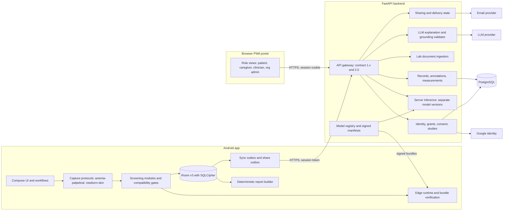
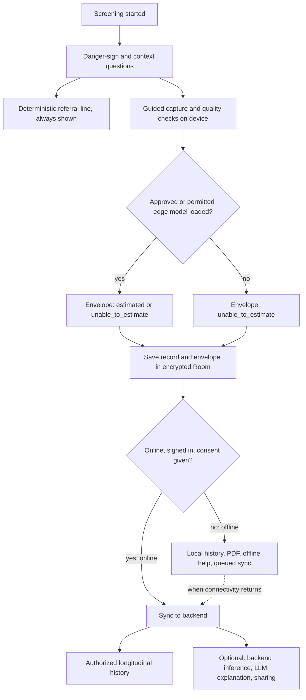
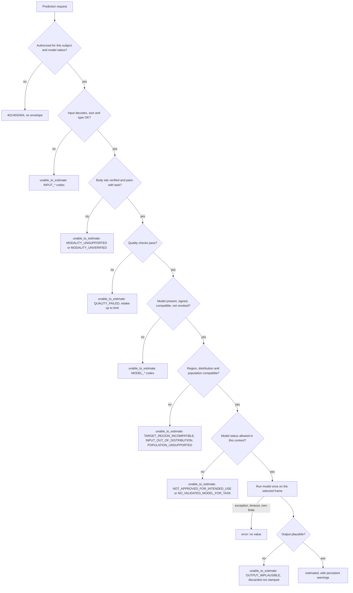
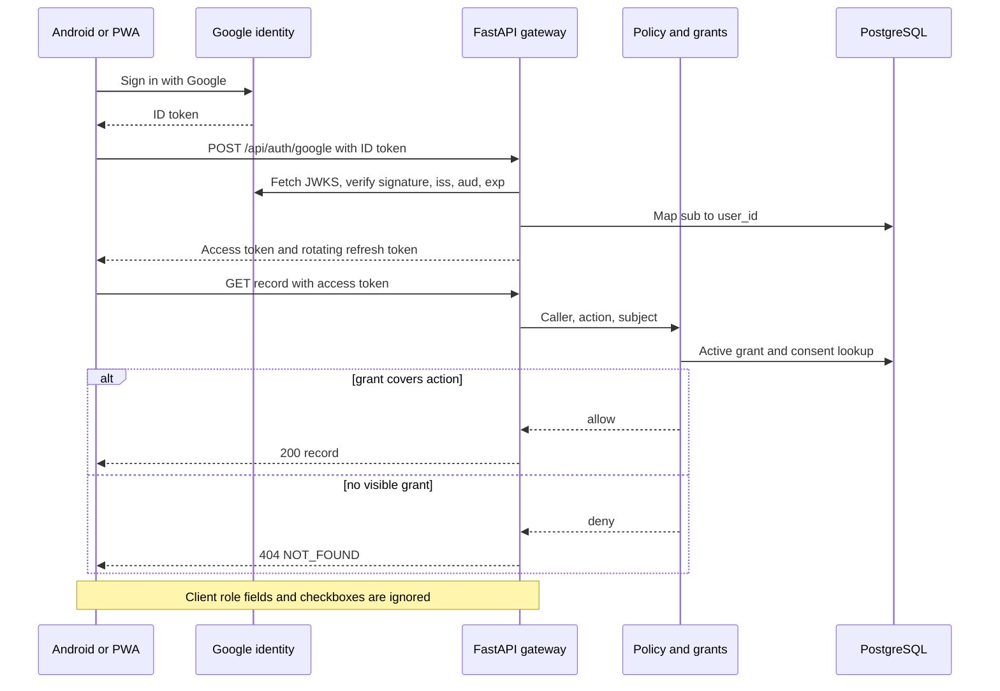
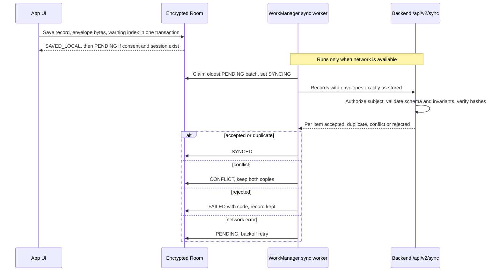

# AbhayNayan architecture: current state and target

24 October 2026. The checklist that moves from one state to the other is [implementation_plan.md](implementation_plan.md). Decisions are recorded in [adr/](adr/). ML detail lives in [ml_architecture.md](ml_architecture.md) and [ml_evaluation.md](ml_evaluation.md).

Sections 1–3 were written in Phase 1. Sections 4–7 were added in Phase 3 and are bound by the Phase 2 evidence in [model_audit.md](model_audit.md). Where they differ, the Phase 3 contracts win: provenance values in §2 rule 1 become `status` + `model.model_status` ([prediction_contract.md](prediction_contract.md)), lab values become `measurements[]` with `source_kind = LAB_MEASURED` ([record_contract.md §4](record_contract.md)), and §3's `BLOCKED_NO_LABELS` is expressed as `NO_VALIDATED_MODEL_FOR_TASK`.

## 1. Current state (verified by inspection and test runs)

```text
Android app (AbhayNayan_apk/AbhayNayan/android)          Browser PWA (AbhayNayan_web/web-dashboard)
 Kotlin 2.2 · Compose · minSdk 26 · targetSdk 36          vanilla JS modules · service worker · IndexedDB
 ├─ Camera2: ambient + torch pair, exposure lock           ├─ camera/file → local quality + colour features
 ├─ ImageQualityChecker (brightness/glare/blur/motion)     ├─ DEMO fixtures for synthetic profiles only
 ├─ cf-v1 colour features (Kotlin == Python to 1e-6)       └─ outbox → /api/sync
 ├─ EdgeModels: JSON linear models, SHA-256 pinned,
 │   research toggle, default OFF, research profiles only
 ├─ Room v4 under SQLCipher (Phase 6; Keystore-wrapped key): patients, screenings
 │   (+ integrity hashes), record_warnings index, referrals
 ├─ WorkManager SyncWorker → /api/sync (demo records only)
 └─ on-device PDF report · FHIR-style JSON · TTS counselling
                │  HTTPS, contract 1.0.0, no auth
                ▼
FastAPI backend (AbhayNayan_web/backend/app) · Python 3.13 · SQLite
 ├─ schemas.py: provenance enum, error envelope, idempotent create/sync
 ├─ model_adapters.py: anemia/jaundice adapters, DISABLED_NO_VALID_MODEL by default
 ├─ ml/: image decode, quality gate, cf-v1 features, registry (SHA-256), ONNX MobileNetV3
 │    /api/ml/hemoglobin, /api/ml/neonatal-jaundice-class (flag ABHAYNAYAN_ENABLE_EXPERIMENTAL_IMAGE_MODELS)
 ├─ gemini.py: rewords 3 counselling fields only; unsafe/claim regex; token telemetry
 ├─ referral PDF · FHIR bundle (HTEST) · dashboard · admin usage (token)
 └─ hosted at abhaynayan-web.onrender.com (Android default)
```

| Concern | Current state | Gap against the product vision |
|---|---|---|
| Identity | None. The only secret is an admin token for the usage report | Google sign-in, roles, relationships, server-side authorization |
| Records | Server: SQLite, single tenant, demo/pseudonymous only. Android: encrypted Room v4 with content hashes and a warning index (Phase 6) | Multi-user PostgreSQL, export/deletion |
| Sync | Stable client IDs, idempotent, per-record result, conflict detection. Demo records only, without envelopes (contract 1.x) | Authorized per-user sync of envelopes with hashes (`/api/v2/sync`, proposed). Real records once authorization exists |
| Edge ML | Research linear models (Hb, NJN class), off by default, pure Kotlin | Per-module descriptors; signed model updates; device latency figures |
| Backend ML | HGB colour model (Hb), MobileNetV3 embeddings + logistic (NJN class), ONNX | Readiness endpoint per module (partly in `/api/ml/models`) |
| Bilirubin | Disabled everywhere; no labels | Blocked on data |
| Capture | Manual ROI, quality gate, flash pair | Per-protocol guidance, multi-frame selection, retry limits |
| Reports | Deterministic structure, but counselling free text (possibly Gemini) is pasted into the PDF | Deterministic body, history, separate grounded explanation |
| Lab documents, chatbot, sharing, portal roles, analytics, App Links | Absent | Stages 7–10 |
| CI | Web repo: Python + web pass; the Android job fails on the stale copy. Android repo: workflow not at repo root, never runs | Working CI in both repos; signed release workflow |

## 2. Target architecture

```text
                    ┌──────────────── Android (offline-first) ────────────────┐
                    │ UI (Compose) ── role-aware screens                      │
                    │ ScreeningModule registry ── Hb · NJN-class · (future)   │
                    │   CaptureProtocol → QualityGate → Localizer → Preproc   │
                    │   → EdgeModel (signed bundle) → OutputValidator → Result│
                    │ Encrypted Room (SQLCipher, Keystore-wrapped key)        │
                    │ Outboxes: sync · share · lab-upload (WorkManager)       │
                    │ Credential Manager (Google) → session token (encrypted) │
                    │ Deterministic ReportBuilder (works offline)             │
                    └──────────────┬──────────────────────────────────────────┘
                                   │ HTTPS · bearer session token · contract 1.x
 Browser portal (same PWA,         ▼
 role views) ──────────────► FastAPI API gateway
                              ├─ auth: verify Google ID token → users/sessions
                              ├─ authz: relationship grants (patient/caregiver/clinician/org admin)
                              ├─ records + sync (PostgreSQL) · audit log (no clinical text)
                              ├─ inference service: module registry, readiness, provenance
                              ├─ lab ingestion: OCR/multimodal → strict schema → user confirm
                              ├─ report service: deterministic facts → optional LLM explanation
                              │    → grounding validator → reject or accept
                              ├─ chatbot: same validator + escalation rules
                              ├─ sharing: email provider (delivery webhooks) · signed expiring links
                              ├─ analytics: aggregate, k-suppressed, district level
                              └─ model release: signed manifests, compatibility checks, rollback
```

### Design rules that apply to every module

1. **Provenance travels with every value**: `DEMO_SYNTHETIC`, `EXPERIMENTAL_RESEARCH_ONLY`, `VALIDATED_FOR_INTENDED_USE`, or `LAB_MEASURED` (new, Stage 7). Lab values and image estimates are stored in different tables and are never averaged.
2. **Fail closed**: missing or invalid model → no value, plus a stated reason. Never a fixture, never a clamp.
3. **Quality before inference**: a frame that fails the gate is never scored. Retries mean recapturing a new image, never re-scoring the same one.
4. **Server decides authorization.** The client's role field is ignored.
5. **Photos stay on the device by default.** Uploading needs a per-record opt-in that is recorded with the record.
6. **The LLM only explains.** Every number, unit, date and next step in its output must come from the supplied fact sheet; otherwise the response is rejected and the deterministic text is shown.
7. **App version ≠ model version.** Each result stores `module_id`, `model_version`, `artifact_sha256` and `app_version`.

## 3. Module descriptor (Stage 14 target)

```text
ScreeningModule {
  id: "anemia-hb-conjunctiva" | "neonatal-jaundice-class" | ...
  intended_use, population, contraindications
  capture_protocol: anatomical target, lighting, distance, frames, retry_limit
  quality_rules: thresholds with the measurement each uses
  preprocessing: feature_version (cf-v1) | tensor spec (shape, colour space, normalisation)
  output: name, unit, plausible range, uncertainty kind (none | interval | calibrated prob)
  model: version, sha256, runtime, validation_status, evaluation report link
  reporting: allowed statements, required limitations, escalation rules
}
```

Hb and NJN-class map onto this today. Bilirubin is declared as a module with `model: none` and status `BLOCKED_NO_LABELS`.

## 4. Components (Phase 3)

Phase numbers refer to the execution phases in the project brief: 4 foundation · 5 capture · 6 offline Android · 7 inference · 8 identity · 9 reports and lab ingestion · 10 LLM · 11 sharing, portal, analytics · 12 updates · 13 modules · 14 final verification.

Facts the design starts from (audit): the Android app does **not** send images to the backend and does not call `/api/ml/*`; it syncs only synthetic demo records; there is no authentication; research switches are off by default and stay off.

### 4.1 Android application and guided capture

| | |
|---|---|
| Responsibility | Workflow UI, camera control, running a capture protocol, local quality checks, calling the edge module, saving records, showing outcomes and referral lines. Owns no clinical logic beyond the deterministic `ReferralRules` |
| Inputs → outputs | Camera2 frames / gallery image + coded context → a selected frame + capture provenance → module → envelope + record |
| Data and trust | Device holds the records it created and any it synced down. Treats its own clock and storage as untrusted for authorization: permissions come only from server-signed tokens (§4.6) |
| Failure | Camera unavailable, retry limit or any check failing ⇒ `unable_to_estimate` with a reason, plus the referral line. Never a placeholder value |
| Depends on | 4.2/4.3 modules, 4.4 runtime, 4.7 storage; 4.6 only when signed in |
| Phase | 5 (capture), 6 (offline foundation) |

### 4.2 Anemia capture and inference module (`anemia-palpebral` → `hemoglobin_from_palpebral_conjunctiva`)

| | |
|---|---|
| Responsibility | Protocol in [capture_protocols.md §2](capture_protocols.md); compatibility gating; calling the Hb model only with a **segmented** conjunctiva region |
| Inputs → outputs | Selected frame + segmentation result + subject population → envelope |
| Data and trust | Never trusts "user confirmed" as body-site verification |
| Failure | Guide-rectangle crops are always `TARGET_REGION_INCOMPATIBLE`. That is every capture today, because no segmentation step exists (audit H3, §5.1). OOD ⇒ `INPUT_OUT_OF_DISTRIBUTION`; pregnancy ⇒ `POPULATION_UNSUPPORTED` |
| Depends on | 4.4, a future segmentation component (blocked on licensed data and validation) |
| Phase | 5 (protocol), 7 (gating) |

### 4.3 Newborn capture and inference module (`newborn-skin`)

| | |
|---|---|
| Responsibility | Danger-sign and age triage **before** capture; skin capture (forehead/sternum); `bilirubin_from_skin`, which always returns `NO_VALIDATED_MODEL_FOR_TASK`; the NJN dataset-class score only for `newborn_skin_whole_view` in a research context |
| Inputs → outputs | Age in hours, danger signs, skin frame → referral line (always) + envelope |
| Data and trust | The skin-trained classifier never receives eye images. The sclera path is retired as an inference input (audit M1) |
| Failure | Any incompatibility ⇒ `unable_to_estimate`; danger signs ⇒ urgent referral regardless of everything else |
| Depends on | 4.4; deterministic `ReferralRules` |
| Phase | 5, 7 |

### 4.4 Edge model runtime and artifact verification

| | |
|---|---|
| Responsibility | Load a model bundle (`metadata.json` + artifact), verify SHA-256 against a **signed manifest**, check `feature_contract`, input/output schema, runtime and `model_status`, then run it (pure Kotlin today; LiteRT only per [ADR-006](adr/ADR-006-edge-runtime.md)) |
| Inputs → outputs | Bundle bytes + manifest → loaded model or a typed refusal (`MODEL_MISSING`, `MODEL_INTEGRITY_FAILED`, `MODEL_INCOMPATIBLE`, `MODEL_REVOKED`) |
| Data and trust | The app trusts only bundles signed with the release key whose public half ships in the APK. The jaundice-class artifact gets the same pin as Hb (audit M4) |
| Failure | Any check failing ⇒ model not loaded ⇒ `unable_to_estimate`. Never a fallback model or fixture |
| Depends on | 4.14 release process |
| Phase | 7 (verification), 12 (signed updates) |

### 4.5 FastAPI backend and server inference

| | |
|---|---|
| Responsibility | API gateway (contract 2.0 next to 1.x), validation, readiness, server-side inference with **separately versioned** models, record storage, reports, sharing and LLM orchestration |
| Inputs → outputs | Authenticated requests → envelopes, records, reports. A backend result is a **separate** prediction (`inference_source = backend`) and never overwrites an edge result |
| Data and trust | Trusts nothing from clients except a verified identity. Re-validates every envelope received through sync |
| Failure | Uses the error and status mapping in [prediction_contract.md §15](prediction_contract.md). Model load failures surface in a readiness endpoint (audit L1); they are not cached silently forever |
| Depends on | 4.6, 4.8, model registry |
| Phase | 4 (readiness, limits, EXIF fix), 7 (contract 2.0 inference) |

### 4.6 Authentication, authorization, consent, relationships

| | |
|---|---|
| Responsibility | Google ID-token verification, sessions, roles, grants, guardian relationships, consents, studies, offline permission tokens ([security_and_permissions.md](security_and_permissions.md)) |
| Inputs → outputs | ID token → session; request + resource → allow / 403 / 404 |
| Data and trust | The server is the only authority. Client role fields and checkboxes are ignored |
| Failure | Deny by default; 401 codes in [security_and_permissions.md §1.2](security_and_permissions.md); offline the app falls back to `anonymous_local` capabilities |
| Depends on | 4.8; OAuth client IDs (**open**) |
| Phase | 8 |

### 4.7 Encrypted local records and offline sync queue

| | |
|---|---|
| Responsibility | Room under SQLCipher with a Keystore-wrapped key ([ADR-005](adr/ADR-005-local-encryption.md)); immutable envelopes; derived warning index; sync outbox with WorkManager ([record_contract.md](record_contract.md)) |
| Status (Phase 6) | **Implemented:** encryption, plaintext → encrypted move, Room v4 integrity columns, `record_warnings`, immutability triggers, verification on load/export/sync, Q9 `error` records. **Not implemented:** the outbox table, envelope sync (no endpoint), annotations. Emulator-verified only |
| Local-first boundary | `ScreeningRepository` over the encrypted database is the source of truth on the phone. Reads never use the network. Saves never wait for a server. Sync changes only sync columns, and the DB triggers enforce this. Storage failures (`StoreFailure`, a "records are locked" screen) are shown separately from sync failures (a record's sync state and message). Offline access never runs a model or relaxes a refusal |
| Inputs → outputs | Records → durable rows; outbox → `/api/v2/sync` batches → per-item `accepted / duplicate / conflict / rejected` |
| Data and trust | The device owns local copies. Sync needs a session, a `cloud_sync` consent and a grant for the subject |
| Failure | Network or 5xx ⇒ backoff retry; rejected ⇒ `FAILED` with code, kept locally; conflict ⇒ both copies kept. Never deletes a local record because sync failed |
| Depends on | 4.6 for sync; nothing for local use |
| Phase | 6 |

### 4.8 Backend database and authorized longitudinal history

| | |
|---|---|
| Responsibility | PostgreSQL ([ADR-003](adr/ADR-003-server-database.md)): subjects, records, predictions (verbatim), annotations, measurements, grants, consents, studies, audit log |
| Inputs → outputs | Authorized writes → rows; history queries → only rows the caller's grants cover, separated by `status`, `model_status` and `source_kind` |
| Data and trust | History never merges image estimates with lab measurements and never shows research results outside research views |
| Failure | DB unavailable ⇒ 503 + `retryable`; clients keep queuing |
| Depends on | Database host (**open**) |
| Phase | 6 (schema), 8 (access control) |

### 4.9 Structured reports and warning preservation

| | |
|---|---|
| Responsibility | Deterministic report from the stored record: IDs, dates, outcome (value only if `estimated`/`synthetic_fixture`), unit, model ID/version/status, inference source, quality and compatibility summaries, **all warnings and annotations**, prior results of the same task (labelled by status), confirmed lab measurements in their own section, limitations, referral line |
| Inputs → outputs | Record(s) → report document → PDF / text / FHIR. Works on device offline and on the server |
| Data and trust | The LLM never writes the report body. An explanation (4.11) is a separate, labelled section |
| Failure | The export validator refuses output if the warning count drops or a value appears for a non-estimate status (AC-REC-05) |
| Depends on | 4.7 / 4.8 |
| Phase | 9 (fixes audit F3) |

### 4.10 Laboratory-report ingestion (PDF and images)

| | |
|---|---|
| Responsibility | Server-side extraction for a **defined first scope** (CBC hemoglobin; total/direct bilirubin). OCR or a multimodal model fills a strict schema; anything uncertain goes to user confirmation ([record_contract.md §4](record_contract.md)) |
| Inputs → outputs | Document (with an explicit consent purpose) → `measurements[]` in `needs_confirmation` → `confirmed` after the user reviews |
| Data and trust | Values only from the document; reference ranges only as printed; exact unit conversions only; original kept |
| Failure | Unsupported test, unit or layout ⇒ explicit "not extracted", never a guess |
| Depends on | 4.6, 4.8; provider choice (**open**, Phase 9) |
| Phase | 9 |

### 4.11 Optional server-side LLM explanation and chatbot

| | |
|---|---|
| Responsibility | Explain a report and answer general health-information questions, grounded in a **fact sheet** built from the stored record plus approved reference text |
| Inputs → outputs | Fact sheet (minimal, consented `external_ai_explanation`) → fixed response schema → grounding validator → accepted explanation or deterministic fallback |
| Data and trust | The provider key stays on the server (as today in `gemini.py`). The LLM output is untrusted text. It is rejected if it contains any number+unit absent from the fact sheet, any value for a non-estimate result, diagnosis/treatment/dose phrases (extending today's `_UNSAFE` patterns), or invented reference ranges. Urgent neonatal or danger-sign questions get fixed escalation copy and no generated text |
| Failure | Offline, unconsented, provider error or validator rejection ⇒ reviewed static text, labelled as such. The UI never claims the LLM is available offline |
| Depends on | 4.9, 4.6 |
| Phase | 10 |

### 4.12 Email and WhatsApp sharing with delivery state

| | |
|---|---|
| Responsibility | Share a validated report: choose recipient and channel → confirm → queue (offline) → send |
| Inputs → outputs | Report + recipient + consent → share item with state `QUEUED → HANDED_OFF` (system share sheet / WhatsApp intent: the app cannot know more) or `QUEUED → SENT → DELIVERED / BOUNCED` (server email **only** with provider webhooks) |
| Data and trust | Prefer expiring, access-controlled links over attachments. No values in notification previews or logs |
| Failure | Never reports "delivered" without provider confirmation; failed sends stay visible and retry under a capped policy |
| Depends on | 4.9, 4.6; provider choice (**open**) |
| Phase | 11 |

### 4.13 Browser patient and clinician portal

| | |
|---|---|
| Responsibility | The existing PWA evolves into role views (patient, caregiver, clinician, org admin, research operator) on the same API and authorization |
| Inputs → outputs | Session cookie → the same contract-2.0 records and reports as Android; aggregate analytics with k-suppression for org admins |
| Data and trust | No public URLs to records. Android App Links fall back to the website, and installing the app is never required |
| Failure | Same codes as the API; offline PWA keeps its IndexedDB outbox |
| Depends on | 4.5, 4.6, 4.8; production domain (**open**) |
| Phase | 11 |

### 4.14 Model updates, app releases, monitoring and tests

| | |
|---|---|
| Responsibility | CI in both repos (fixes F1/F2, **awaiting approval**); signed release APKs (key outside Git); **model releases separate from app releases**: a signed manifest {model_id, version, SHA-256s, schema versions, minimum app version, lifecycle stage}, staged rollout, last known-good kept for rollback; monitoring of reason-code rates and error rates only (no clinical content) |
| Inputs → outputs | Tagged commits → tested artifacts; signed manifests → device/server model activation or refusal |
| Data and trust | A remote flag can disable a model but never raise its status ([prediction_contract.md §12](prediction_contract.md)). The app never installs code from GitHub pushes. Local builds containing research assets are not distributed (audit M7) |
| Failure | Bad signature, incompatible schema or app too old ⇒ keep the current model; revoked ⇒ unload and annotate |
| Depends on | Signing keys (**open**) |
| Phase | 4 (CI), 12 (releases, model updates), 13 (module registry), 14 (verification) |

## 5. Online and offline operation

| Capability | Offline (no network) | Online, signed out | Online, signed in |
|---|---|---|---|
| Capture, quality checks, guidance | yes | yes | yes |
| Edge inference | only an **approved** model, or research under a valid offline permission token | same | same |
| Backend inference | not available, shown as "needs connection" | no | per grants and model status |
| Local records, history, PDF | yes (encrypted) | yes | yes |
| Sync | queued (`PENDING`/`LOCAL_ONLY`) | queued | yes, with consent |
| LLM explanation / chatbot | **not available**; reviewed static help is labelled "offline help" | no | with consent |
| Lab document ingestion | documents can be queued locally (explicit consent) | no | yes |
| Sharing | system share sheet works (`HANDED_OFF`); server email queued | system share only | yes |
| Danger-sign triage and referral lines | yes, always | yes | yes |

Nothing in the offline column depends on the backend or the LLM. The UI states which features need a connection instead of failing silently.

## 6. Diagrams

### 6.1 System architecture



### 6.2 Online vs offline data flow



### 6.3 Prediction request and safe failure paths



### 6.4 Authentication and authorization boundaries



### 6.5 Offline record synchronization



## 7. Model lifecycle and release safety (summary)

`proposed → data_licence_verified → trained → evaluated_held_out → integration_tested → research_only → approved_for_intended_use`, with `suspended`, `revoked` and `retired` side states. Gates and evidence: [prediction_contract.md §12](prediction_contract.md). Key rules:

- **All current datasets are blocked at `data_licence_verified`** pending licence review.
- Patient-level splits where IDs exist; documented grouping where they do not (NJN); selection recorded before a single test run; evaluation in the **app's own input format** is required.
- Edge and backend models have independent versions; each result records its own.
- Reproducibility: training config, manifest hash, seed, environment and commit saved. Rollback keeps the last known-good bundle.
- **Do not redistribute the locally built debug APK that contains research model assets.**
