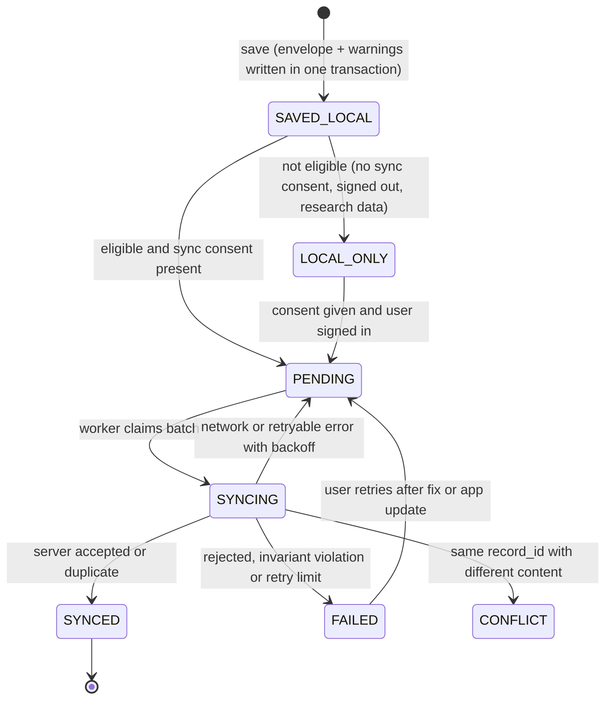

# Record contract (`abhaynayan.record/2.0.0`)

Status: **Design (Phase 3, 24 October 2026). Not implemented.** Implementation: Android Room v3 + outbox in Phase 6; server storage in Phases 6–8; reports in Phase 9. The prediction inside a record is defined in [prediction_contract.md](prediction_contract.md).

**Phase 5 (24 October 2026), safe portion implemented on Android:** Room schema v3 adds a nullable `screenings.predictionJson` column holding the envelope exactly as produced (auto-migration 2→3, verified by `scripts/verify_room_migration.py` and an emulator upgrade). Records from v2 keep `NULL` and display as legacy.

**Phase 6 (24 October 2026), implemented on Android:**
- the database is encrypted ([ADR-005](adr/ADR-005-local-encryption.md));
- Room schema v4 adds integrity metadata and the derived `record_warnings` index (§8);
- every stored record is classified as sealed at save or as a legacy record hashed at migration (§8.4);
- migrations are covered from v1, v2 and v3 (§9).

These are implemented **on the existing `screenings` table**, not as the separate `records`/`predictions`/`annotations`/`sync_outbox` tables sketched in §5. That restructuring, `legacy_source`, annotations and envelope sync are still design: there is no server endpoint for them (§8.6).

## 1. Principles

1. **The prediction envelope is immutable.** It is stored as the exact bytes produced, plus its SHA-256. No later step (sync, migration, app update, export, LLM, clinician review) edits it.
2. **Warnings are append-only.** New information arrives as *annotations* linked to `result_id`, never by editing the envelope.
3. **Measurements and estimates never mix.** Laboratory values live in `measurements[]` with their own provenance and are never averaged or reconciled with image estimates.
4. **Minimal data.** Pseudonymous subject IDs; no names, phone numbers, addresses, images or free text in synced records by default.
5. **Old records stay readable** under every later app version (§6).

## 2. Record structure

| Block | Field | Mutable? | Notes |
|---|---|---|---|
| identity | `schema` = `abhaynayan.record/2.0.0` | no | |
| | `record_id` `scr-<uuid4>` | no | created once on the device or server; reused on every retry (unchanged from contract 1.x) |
| | `created_at`, `created_by` {`actor_role`, `user_ref` or `local_device`} | no | `user_ref` is the opaque server user ID after sign-in, never an email |
| subject | `subject_ref` {`subject_id`, `subject_kind`: `person` \| `dependent` \| `synthetic_test`} | no | `synthetic_test` subjects exist only when created by the server ([security_and_permissions.md §6](security_and_permissions.md)) |
| workflow | `workflow`: `maternal_anemia` \| `neonatal_jaundice` | no | |
| context | `context` {`infant_age_hours`, `gestational_week`, `gestational_age_at_birth_weeks`, `pregnancy`, `visible_jaundice`, `phototherapy`, `danger_signs[]`} | no (corrections create a new record version, §2.1) | coded values only |
| capture | `capture` {`protocol` id/version, `rules_version`, `source`, `device_model`, `os_version`, `burst` {`frames_captured`, `frames_passed`, `selected_index`, `selection_rule`}, `frame_metadata`} | no | no device identifiers; the image is not stored by default |
| prediction | `predictions[]`: each `{envelope_json, envelope_sha256}` | no | normally one per record; a backend second opinion is a **separate** entry with `inference_source = backend`, never a replacement |
| annotations | `annotations[]` {`annotation_id`, `result_id`, `warning` (same structure as envelope warnings, `origin.source = server_annotation`), `created_at`, `created_by`} | append-only | e.g. `MODEL_REVOKED_AFTER_RESULT` |
| measurements | `measurements[]` (§4) | append-only | lab results, user-confirmed |
| referral | `referral` {`urgency`, `rule_version`, `next_step_key`} | no | from deterministic `ReferralRules`, never from a model or LLM |
| consent | `consent_refs` {`local_storage`, `sync`, `research`, `sharing`} → consent record IDs, or `null` | append-only | consent records live in the consent store ([security_and_permissions.md §4](security_and_permissions.md)) |
| sync | `sync` {`state`, `attempts`, `last_error_code`, `last_attempt_at`, `server_received_at`, `server_version`} | yes (device-local) | not part of the record's signed content |
| integrity | `content_sha256` | recomputed on new version | hash of all immutable blocks, canonical JSON |
| legacy | `legacy_source` {`schema`, `json`} or `null` | no | original Room v2 / contract 1.x row, kept verbatim after migration |

### 2.1 Corrections

A wrong context entry (for example, the wrong infant age) is corrected by creating a **new record version** (`record_version` + 1, `supersedes` = previous `content_sha256`) that keeps the same envelope. Both versions are kept, and the report shows the latest with "corrected" plus the history. If the correction changes compatibility (for example, the age now falls outside the model's population), the old envelope stays as it was and a `CONTEXT_CORRECTED_AFTER_RESULT` annotation is added. Inference is not re-run, because the image is not retained.

## 3. Lifecycle

Sharing has its own outbox and state machine (Phase 11); sharing never changes `sync.state`.

### Required behaviours

| Situation | Behaviour |
|---|---|
| **Saved offline** | Room transaction writes the record, the envelope bytes + SHA-256, and a denormalised `record_warnings` index together; on failure nothing is written. Works with no network, no sign-in and no backend ([architecture.md §5](architecture.md)) |
| **Synced later** | Sends the record with the envelope **as stored**. The server: checks authorization for the subject; validates the envelope against its `schema` version and the invariants in [prediction_contract.md §11](prediction_contract.md); verifies `envelope_sha256` and `content_sha256`; stores verbatim. Invalid ⇒ `rejected` with a code; the device keeps the record as `FAILED`, and nothing is repaired or stripped. Same `record_id` + same `content_sha256` ⇒ `duplicate`. Same `record_id` + different content ⇒ `conflict`; the server keeps its copy, the device keeps its copy, and both are shown for review |
| **Exported or shared** | The export is generated from the stored record. It **must include every warning and annotation**, the model ID/version/SHA-256, inference source, model status, quality and compatibility summaries, record and result IDs, and timestamps. The export validator refuses to produce an export whose warning count is lower than the record's. FHIR export puts warnings in `Observation.note` and a project extension with the code; text/PDF list them in a "Warnings" section that cannot be hidden |
| **Model no longer available** | The stored envelope still contains model ID, version, SHA-256 and model-card reference. The registry tombstone (permanent) supplies the card. The display shows the stored value with its original labels plus any `MODEL_REVOKED_AFTER_RESULT` annotation. Nothing is re-inferred |
| **Schema changes** | Readers keep a decoder per published `schema`. MINOR: new optional fields; old readers ignore unknown fields (except §6 rule 3). MAJOR: a written migration that **wraps** the old record and keeps the original in `legacy_source` |
| **Warning on the original inference, app updated before sync** | The update must not touch stored envelopes. The Room migration copies envelope bytes unchanged and rebuilds only the derived `record_warnings` index from them. The next sync sends the original bytes with the original `producer.software_version`. A migration test asserts that the warning count and envelope SHA-256 are identical before and after (AC-REC-04) |

## 4. Laboratory measurements (`measurements[]`)

| Field | Notes |
|---|---|
| `measurement_id` | `msr-<uuid4>` |
| `analyte` | first scope: `hemoglobin`, `bilirubin_total`, `bilirubin_direct` (coded) |
| `value`, `unit` | as printed; units whitelisted: g/dL, g/L, mg/dL, µmol/L |
| `normalized` {`value`, `unit`, `conversion_rule`} or `null` | only exact, documented conversions (g/L ÷ 10 → g/dL; bilirubin µmol/L ÷ 17.1 → mg/dL, factor recorded); `null` if not exact. The original value is always kept |
| `reference_range` {`low`, `high`, `unit`, `as_printed`} or `null` | copied from the document only; never generated |
| `collected_at`, `reported_at` | from the document; `null` if absent. Never inferred |
| `source` {`kind`: `lab_document` \| `manual_entry`, `document_id`, `page`, `bbox`, `extraction_method` {`ocr:<engine>@<ver>` \| `llm:<model>@<ver>`}, `field_confidence`} | provenance of every value |
| `review` {`status`: `needs_confirmation` \| `confirmed` \| `rejected`, `confirmed_by`, `confirmed_at`} | values with low confidence, ambiguous units or conflicts stay `needs_confirmation` and are never used in history, charts or LLM context |
| `source_kind` | always `LAB_MEASURED`, so it can never be confused with an image estimate |

## 5. Storage mapping

**Implemented today (Room v4):** see §8. **Target design (not implemented):** **Android Room** (encrypted, [ADR-005](adr/ADR-005-local-encryption.md)): `records` (immutable blocks as canonical JSON + columns for queries), `predictions` (`result_id`, `record_id`, `envelope_json`, `envelope_sha256`), `record_warnings` (derived index: `result_id`, `code`, `severity`, `origin`; rebuildable from the envelope), `annotations`, `measurements`, `record_events` (append-only audit of state changes, with codes only), `sync_outbox`. Migration v2→v3: each v2 `screenings` row becomes a record whose `legacy_source.json` is the v2 row and whose envelope follows [prediction_contract.md §10](prediction_contract.md), with `LEGACY_WARNINGS_NOT_RECORDED` where v2 could not have stored OOD state. The obsolete `confidencePlaceholder` is preserved only inside `legacy_source`.

**Server** (PostgreSQL target, [ADR-003](adr/ADR-003-server-database.md)): the same entities, plus `subjects`, `grants` and `consents`. Envelope JSON is stored as received (JSONB plus a raw-bytes column for hash verification). Row-level access is always filtered by grant (Phase 8).

## 6. Backward-compatibility rules for readers

1. Unknown `schema` MAJOR ⇒ show "This record was created by a newer version; update the app" plus the IDs. Never guess at fields.
2. Unknown warning code ⇒ display it generically (never drop it).
3. Unknown `status`, `screening_type`, `model_status` or `inference_source` ⇒ treat the record as unreadable for clinical display (fail closed), still list it, and do not export it as a result.
4. Missing optional MINOR fields ⇒ show "not recorded", never a default value.

## 7. Logs, identifiers and telemetry

- `record_id`, `result_id`, `trace_id` and `annotation_id` are random UUIDs. They are never built from names, phone numbers, dates of birth, device IDs or image hashes.
- Logs and audit events carry IDs, codes, durations and counts only: no values, no units with values, no context fields, no warning params, no free text. This follows the existing `SafeLog` / `unexpected_error_handler` pattern.
- Crash reports, analytics and notifications never contain record content ([security_and_permissions.md §8](security_and_permissions.md)).

## 8. Record integrity (implemented, Android Room v4, `abhaynayan.record-hash/1`)

### 8.1 Stored metadata

| Column (`screenings`) | Meaning |
|---|---|
| `screeningId` | Stable record ID `scr-<uuid4>`, created once and reused on every retry (unchanged) |
| `predictionSha256` | SHA-256 of `predictionJson`'s UTF-8 bytes exactly as stored; `null` when the record has no envelope |
| `contentSha256` | SHA-256 of the canonical payload (§8.2) |
| `integrityVersion` | `abhaynayan.record-hash/1`; a different value is reported as "created by a newer app version", never as verified |
| `recordOrigin` | `SEALED_AT_SAVE`, `LEGACY_OUTCOME_V3` or `LEGACY_NO_OUTCOME` (§8.4) |
| `integrityBaselineAtUtc` | Legacy records only: when the hashes were first computed (the migration time) |

All of these are written once, in the same transaction as the record, and are covered by an `UPDATE` trigger (§8.5).

### 8.2 Canonical payload and serialization

**Fields included:**
- `hash_version`, `record_id`, `patient_id`, `screening_type`, `estimate`, `unit`, `demo_tag`, `confidence_placeholder`, `capture_quality_proxy`, `model_mode`, `synthetic`, `confirmation_required`, `created_at`, `result_mode`, `case_id`, `model_version`, `quality_status`, `capture_source`, `differential_status`, `metadata_json`, `referral_urgency`, `worker_id`, `phc`;
- `prediction_sha256`, which covers the envelope: status, reason code, every warning in order, model, input, quality, compatibility and producer;
- `record_origin` and `integrity_baseline_at`.

**Fields excluded:**
- device-local transport metadata: `syncState`, `syncAttempts`, `lastSyncError`, `lastSyncAttemptAtUtc`, `serverConfirmedAtUtc`;
- the hash itself.

There are no keys, secrets or images in the payload, because none is stored in a record.

**Serialization:**
- a flat JSON object with keys sorted by Unicode code point, no whitespace, encoded as UTF-8;
- strings escape only `"`, `\` and U+0000–U+001F, using `\b \f \n \r \t` where they exist and otherwise `\u00xx` (lower case);
- integers and booleans are JSON literals and `null` is `null`;
- doubles are JSON **strings** of their exact decimal value (`BigDecimal(double).toPlainString()` / Python `format(Decimal(x), 'f')`), with `-0.0` written as `"0"`;
- NaN and infinities cannot be hashed and are refused.

Ordinary map serialization is never used. Kotlin (`RecordIntegrity`) and Python (`backend/app/core/record_integrity.py`) produce identical bytes for the shared vectors in `tests/fixtures/record_integrity_vectors.json`, which is copied to the Android test resources.

### 8.3 Warning index and preservation

- `record_warnings` (`screeningId`, `position`, `resultId`, `code`, `severity`, `originSource`; primary key (`screeningId`, `position`); index on `code`) has one row per warning in the stored envelope, in envelope order, with duplicates kept.
- It is derived. The envelope's warning list stays the source of truth, with full detail (params, component, software version, time).
- The rows are written in the same transaction as the record. `ScreeningRepository.recordsWithWarning(code)` filters through the index.
- Warning order is significant: it is part of the stored bytes, so reordering changes `predictionSha256`. Canonicalization never sorts or de-duplicates warnings.
- Verification compares the stored index, by position, with the index rebuilt from the envelope. An added, removed, reordered or edited row is reported as "warning index does not match the envelope".

### 8.4 Verification and legacy records

`RecordIntegrity.verify` recomputes both hashes and the index:
- when a record is **loaded** (record screen);
- before it is **exported** (PDF, text report);
- before it is **prepared for sync** (contract 1.x demo sync and the v2 preparation in §8.6).

| Result | Shown as | Meaning |
|---|---|---|
| `VerifiedSinceSave` | "unchanged since it was saved" | `SEALED_AT_SAVE` and every hash matches |
| `UnchangedSinceMigration` | "older record, history not verifiable", with the baseline time | Legacy record unchanged since it was first hashed during the v3 → v4 migration. Anything before that cannot be checked |
| `Mismatch` | "Integrity check failed" | No value, report, counselling or sharing is shown. Export and sync are refused, and sync sets `FAILED` with an integrity message. **The stored hash is never overwritten or "repaired"** |
| `NotSealed` / `UnsupportedVersion` | "not recorded" / "created by a newer app version" | Never shown as verified |

"Migration succeeded" and "integrity verified" are different statements.
- **Legacy origins:** a migrated row becomes `LEGACY_OUTCOME_V3` (it has a Phase 5 envelope) or `LEGACY_NO_OUTCOME` (saved before envelopes existed). Its hashes describe the record **as found at migration**.
- **Nothing is inferred for legacy rows:**
  - no envelope, warning, capture modality, model version or timestamp is created;
  - `estimate` and `predictionJson` stay as stored, including `null`;
  - fields that an earlier version never had keep the defaults the earlier migrations already wrote (for example `qualityStatus = NOT_RECORDED`) and are displayed as "Not recorded".
- **v1 vs v2 rows:** whether a `LEGACY_NO_OUTCOME` row was first written by schema v1 or v2 cannot be recovered and is not claimed.

### 8.5 Immutability

SQLite triggers, created by the v3 → v4 migration and re-created idempotently on every open:
- `screenings_sealed_immutable` aborts any `UPDATE` that changes a hashed or integrity column of a sealed row. Sync columns stay writable.
- `record_warnings_immutable` aborts any update of an index row.
- `record_warnings_keep_with_record` aborts deleting an index row while its record exists. "Delete all local data" removes records first, then the index.

A server response can therefore change only sync columns. It cannot remove a warning from a stored outcome.

**Limits of a hash:** the triggers and hashes stop the app's own code paths, a sync response and accidental or partial edits. A content hash is **not a signature or proof of authenticity**: anyone who can write the decrypted database can rewrite a record, its hashes and the triggers together.

### 8.6 Sync

- **No compatible endpoint exists.** API contract 1.3.0's `/api/sync` accepts only the 1.x `ScreeningResult` (synthetic demo fixtures with a number) and rejects unknown fields. It cannot carry envelopes, warnings or hashes.
- **What is sent:** demo records keep syncing as before, without their envelope. The app says that the server received the demo summary only.
- **Integrity gate:** a record that fails verification is never sent.
- **Everything else stays `LOCAL_ONLY`.**
- **v2 preparation:** `OutcomeSync.prepare` builds the v2 item for the proposed endpoint ([API_CONTRACT.md](API_CONTRACT.md), "Record sync v2 (proposed)"), and `backend/app/core/record_integrity.verify_item` checks one. Both are tested; neither is wired to a worker or a route.

## 9. Local database migrations (Android)

| From | To | How | Verified |
|---|---|---|---|
| plaintext v1, v2 or v3 (`abhaynayan-local.db`) | encrypted copy at the same version | `sqlcipher_export`, verified copy, then plaintext removed ([ADR-005](adr/ADR-005-local-encryption.md)) | instrumented: v1, v2, v3 fixtures; interrupted and failed moves; emulator upgrade of the installed app (5 records) |
| v1 → v2 → v3 | | Room auto-migrations (unchanged) | `scripts/verify_room_migration.py` (desktop SQLite); `runMigrationsAndValidate` under SQLCipher |
| v3 → v4 | | `Migration3To4`: add columns and `record_warnings`, seal every row as legacy, create triggers, all in Room's upgrade transaction | `verify_room_migration.py` (schema); instrumented: 1→4, 2→4, 3→4 validate against `4.json`; idempotent backfill; v3 envelope bytes, SHA-256 and duplicate warnings identical after the upgrade (AC-REC-04) |

- **Failure:** a failed Room migration rolls back to the previous version (SQLCipher's open helper runs upgrades in a transaction) and the store shows "Records could not be opened". Destructive migration is never enabled.
- **Not covered:** downgrades. An older app cannot open a newer database and is not supported.

